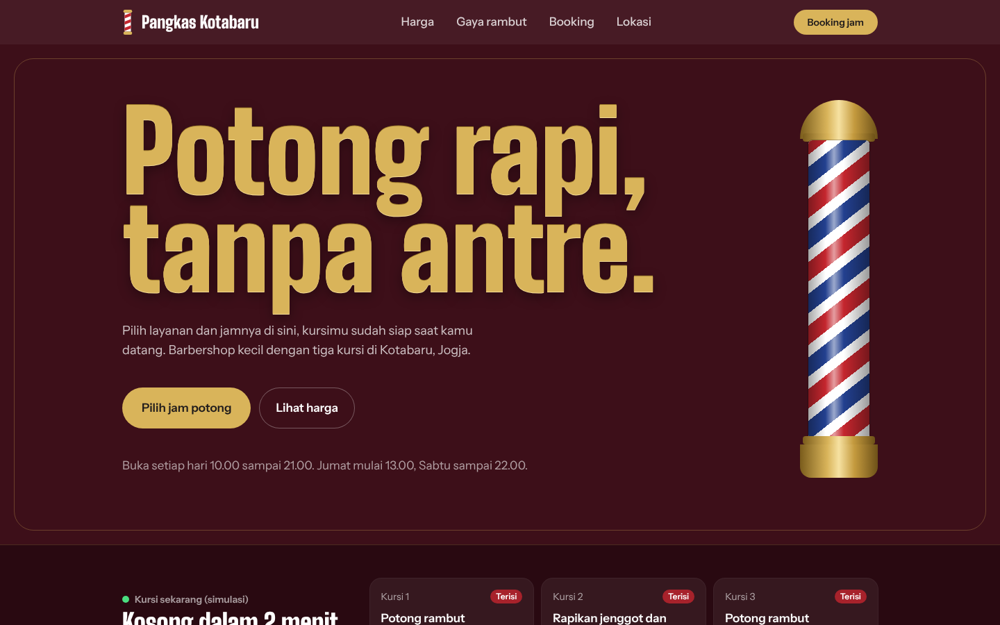
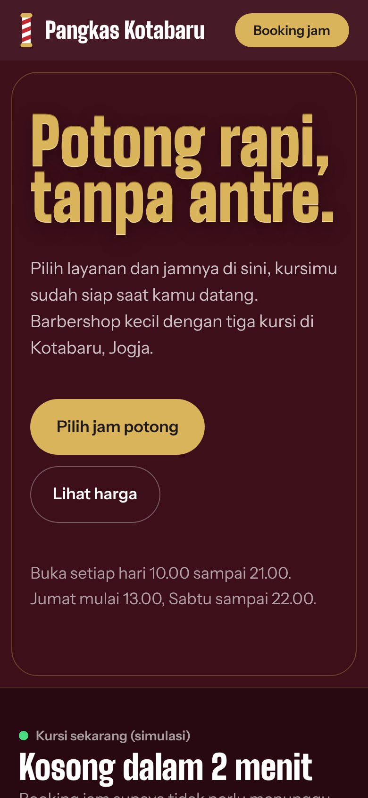

# Pangkas Kotabaru

A landing page and booking page for **Pangkas Kotabaru**, a small three-chair barbershop in Kotabaru, Yogyakarta. Visitors see how busy the shop is, compare hairstyles for their face shape, pick services and a time slot, and book through WhatsApp.

**Live site:** https://pangkas-kotabaru.vercel.app

| Desktop | Mobile |
| --- | --- |
|  |  |

> Pangkas Kotabaru is a fictional business. This site is a portfolio concept by OmGround. The WhatsApp number, the chair status, and the map are placeholders, so no real bookings are sent.

## About the system

Walk-in barbershops lose customers who arrive, see a queue, and leave. This page helps visitors decide when to come and lets them reserve a chair:

1. The visitor checks the chair status to see whether a chair is free now.
2. They preview hairstyles and pick one that suits their face shape.
3. They choose one or more services, a day in the coming week, and a 30-minute slot.
4. One button sends the booking, including the chosen hairstyle, to the shop's WhatsApp.
5. The shop replies with a booking code and holds the chair for 10 minutes.

Everything runs in the browser. There is no backend, database, or login.

## Features

### Hero
- Large condensed headline in gold, styled like the gilded window lettering of old barbershops.
- Barber pole built with CSS. The stripes turn continuously and speed up while the visitor scrolls.

### Live chair status (simulated)
- Three chairs, each showing the current service, a countdown timer, and a progress bar, updated every second.
- A summary such as "2 chairs free" or "Free in 13 minutes" helps the visitor decide between walking in and booking.

### Price list
- Letterboard with white letters on black felt in a wooden frame, a common sight in local barbershops.

### Hairstyle picker
- Four face shapes (oval, round, square, long). The illustrated face changes shape with a smooth animation.
- Six hairstyles (buzz cut, crew cut, side part, two block, comma hair, pompadour) previewed on the illustrated head.
- Each style is marked as suiting or not suiting the selected face shape, with alternatives suggested.
- "Book with this style" carries the style into the booking summary and the WhatsApp message.

### Booking
- Step 1: choose one or more services. The total price and duration add up automatically.
- Step 2: choose a day in the next seven days.
- Step 3: choose a 30-minute slot. Slots follow each day's opening hours (Friday opens at 13.00 for Friday prayers), skip times that have passed today, and leave enough time for the selected services before closing.
- A booking card shows the time, date, services, style, and total.

### WhatsApp booking
- In demo mode, the booking opens as a simulated WhatsApp chat with an automatic reply containing a booking code.
- In live mode, the button opens WhatsApp with the booking message prefilled.

### Location and information
- Illustrated map in a vintage style with landmarks. Tapping one draws the walking route and shows the distance and time.
- Opening hours with today highlighted, parking information, and an FAQ.

## How it works

| Concern | Approach |
| --- | --- |
| Content | Services, prices, hours, hairstyles, face shapes, booking rules, map places, and FAQ live in `lib/data.ts`. |
| Booking slots | Generated in the browser from the opening hours, the total service duration, and the current time in the Asia/Jakarta time zone. |
| Shared state | `StyleProvider` shares the chosen hairstyle between the picker and the booking card. |
| Chair status | Simulated from the current time so it changes every second without a server. Replace it with real data for a live shop. |
| WhatsApp | `WaProvider` opens the chat simulation when `demo` is `true`, or a `wa.me` link when it is `false`. |
| Motion | Motion (Framer Motion) for the pole, face morphing, hair transitions, and route drawing. Respects the reduced-motion setting. |

## Tech stack

| Area | Tools |
| --- | --- |
| Framework | [Next.js 16](https://nextjs.org) (App Router, statically prerendered) |
| UI | React 19, TypeScript |
| Styling | Tailwind CSS v4 |
| Animation | [Motion](https://motion.dev) |
| Fonts | Big Shoulders Display and Instrument Sans, self-hosted via Fontsource |

## Project structure

```
app/
  layout.tsx            Metadata, fonts, and base page setup
  page.tsx              Page sections, barber pole, letterboard
  globals.css           Theme colors, fonts, pole, felt, and tile patterns
  icon.svg, apple-icon.png, opengraph-image.jpg
components/
  live.tsx              Scroll-driven pole stripes and chair status
  hairstyles.tsx        Face shape and hairstyle picker
  style-context.tsx     Shares the chosen hairstyle with the booking
  booking.tsx           Booking steps, summary card, opening hours
  area-map.tsx          Map data and colors for this site
  illustrated-map.tsx   Reusable SVG map with route drawing
  wa-sim.tsx            WhatsApp button and chat simulation
  wa.tsx                WhatsApp link helper, icon, rupiah formatter
  demo-note.tsx         Footer note marking the business as fictional
lib/
  data.ts               All page content
docs/                   Screenshots for this README
```

## Getting started

Requires Node.js 20 or later.

```bash
npm install
npm run dev
```

Open http://localhost:3000. For a production build, run `npm run build` and then `npm start`. Run `npm run lint` to check the code.

## Using it for a real business

1. Replace the name, address, services, prices, hours, and FAQ in `lib/data.ts`.
2. Adjust `booking` for the slot length, how many days ahead can be booked, and the minimum notice for same-day slots.
3. Set `whatsapp.number` to the owner's number in international format and set `whatsapp.demo` to `false`.
4. Connect the chair status to real data, or remove the section.
5. Remove `<DemoNote />` from the footer in `app/page.tsx`.

## Deploying

The project deploys to [Vercel](https://vercel.com) with no extra configuration and no environment variables. Every push to `main` triggers a new production deployment.

## Accessibility

- Works with a keyboard, with visible focus outlines and a skip link.
- Choices use real radio buttons, checkboxes, and pressed-state buttons, so screen readers announce them correctly.
- Animations are reduced when the visitor's system asks for reduced motion.
- Layout tested at phone, tablet, and desktop widths.
